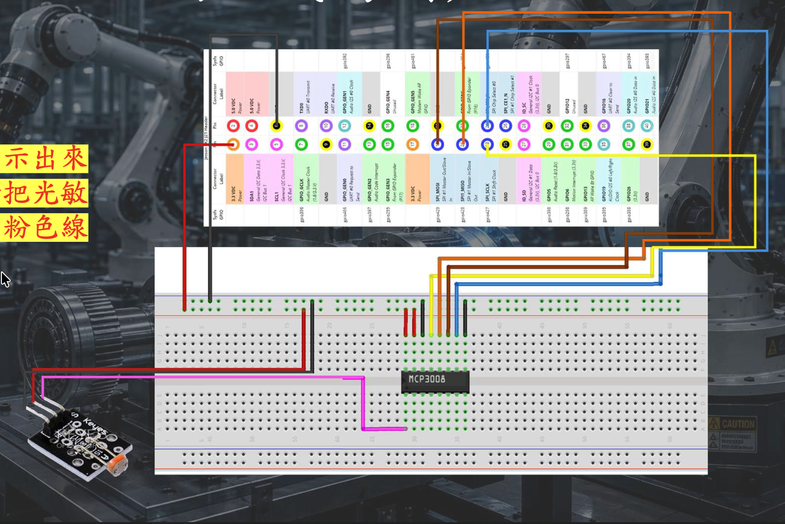

# Lab05 SPI 光敏電阻與防盜快照

依 `Lab5-SPI控制實習_V3.pdf` 第 12-13、20-25、29、32-35 頁，以及 `Lecture5_Microprocessor-Systems_v3.pdf` 第 27-29、37-40 頁實作。兩支主程式共用同資料夾內的 ADC / LED 介面，複製時請一起帶走。

| 教材要求 | 實作 |
| --- | --- |
| 項目一：讀取光敏電阻、Terminal 顯示 ADC（20%） | `light_control.py` |
| 項目二：依門檻控制兩顆 LED、顯示狀態（10%） | 同一支 `light_control.py` |
| 項目三：CSI 相機預覽與截圖（10%） | 下方 GStreamer 指令，不另外寫程式 |
| 項目四：瞬間差值觸發、交替閃燈、連拍三張、持續追拍、回到原基準才復歸（30%） | `security_snapshot.py` |

## 1. 先在 Mac / Ubuntu VM 跑模擬

需要 Python 3.6 以上。模擬與測試只用標準函式庫，無須安裝 GPIO、spidev 或 OpenCV。

Mac 終端機：

```bash
cd /Users/hiyori/Documents/ChatGPT/Microprocessor/microprocessor/Lab05
python3 light_control.py --samples 100,700,550,450,300 --max-samples 5
```

預期 700 時兩燈 ON，550 維持 ON，450 時兩燈 OFF。預設採講義的遲滯門檻：`>=600` 開啟、`<=450` 關閉，中間維持原狀，避免在單一門檻附近閃爍。兩燈在項目二同亮同滅；這是本實作選擇，教材只規定由門檻控制兩燈。

防盜模擬（約四秒，異常持續到第二輪三張後再恢復）：

```bash
python3 security_snapshot.py \
  --samples 300,310,800,805,810,800,805,810,800,805,810,800,805,810,800,805,810,800,310,305 \
  --max-samples 20 --output /tmp/lab5-demo
```

應看到 `ABNORMAL`、`ALARM_LED`、多次 `SNAPSHOT`、`BURST_COMPLETE`，最後 `SYSTEM_RESET`。模擬相機寫入明確標示的 `.simulated.txt`，**不是真實照片**。模擬的 LED 訊息也不代表硬體輸出。

不帶 `--max-samples` 時持續執行；`--samples` 用完後維持最後一個數值。Ctrl+C 結束。有限次執行是測試用途，會在最後一筆後立即清理，可能中止尚未完成的拍攝。

## 2. TX2 J21 接線

先斷電接線，再上電。以下是 **TX2 開發套件 J21 實體 pin**，程式使用 `GPIO.BOARD`，不要將先前 Lab 的 Linux GPIO 編號（例如 255）直接填入 `--led-pins`



### MCP3008 DIP-16

IC 凹口朝上時左上為 pin 1；依晶片標記確認方向。

| MCP3008 腳號 | 名稱 | 接到 TX2 J21 |
| --- | --- | --- |
| 16 | VDD | pin 1，3.3 V |
| 15 | VREF | pin 1，3.3 V |
| 14 | AGND | pin 6，GND |
| 13 | CLK | pin 23 |
| 12 | DOUT / MISO | pin 21 |
| 11 | DIN / MOSI | pin 19 |
| 10 | CS/SHDN | pin 24 |
| 9 | DGND | pin 6，GND |
| 1 | CH0 | 光敏電阻分壓中點 |

分立 LDR 依 Lecture5 第 37 頁接：`3.3 V → 10 kΩ 固定電阻 → CH0 分壓點 → LDR → GND`。光越暗，ADC 通常越大。若使用 Lab 第 18 頁的感測模組，將模組的類比輸出接 CH0，並確認其 VCC / GND / 類比輸出標示；不要把比較器的數位輸出當成類比輸出。VDD、VREF 與感測器採 3.3 V，所有 GND 共地。

### 兩顆 LED

| 名稱 | J21 輸出 | 連法 |
| --- | --- | --- |
| LED1 | pin 15 | GPIO → 限流電阻（例如 1 kΩ）→ LED 正極，負極接 GND pin 14 |
| LED2 | pin 29 | GPIO → 限流電阻（例如 1 kΩ）→ LED 正極，負極接 GND pin 30 |

先前 Lab 的 LED 可能接 pin 21、23；這次兩腳要給 SPI，請先移開那兩顆 LED。預設 pin 15、29 是本實作選擇，仍須確認借用板的 pinmux 與接線；本機測試不能驗證實體腳位。若現場使用低電位點亮的 LED 模組，加入 `--active-low`。

## 3. 從 Ubuntu VM 傳到 TX2

若 Fusion 已掛載名為 Microprocessor 的共享資料夾，在 **Ubuntu VM** 執行：

```bash
ls /mnt/hgfs/Microprocessor/microprocessor/Lab05
TX2_USER=nvidia                 # 換成實際帳號
TX2_IP=192.168.55.1             # 換成已確認可連線的 TX2 IP
scp -r /mnt/hgfs/Microprocessor/microprocessor/Lab05 "$TX2_USER@$TX2_IP:~/"
ssh "$TX2_USER@$TX2_IP"
```

若 VM 路徑不存在，先確認共享資料夾是否掛載；IP 與帳號只是範例，未在本次工作中確認。接下來指令在 **TX2** 執行。

## 4. TX2 環境與 SPI

```bash
cd ~/Lab05
python3 --version
python3 -c 'import Jetson.GPIO as GPIO; print(GPIO.JETSON_INFO)'
python3 -c 'import spidev; print("spidev import OK")'
python3 -c 'import cv2; print(cv2.__version__); print(cv2.getBuildInformation())'
ls -l /dev/spidev*
gst-inspect-1.0 nvarguscamerasrc
```

使用板上既有且符合 JetPack 的套件。缺少模組時，再依課程環境安裝 `Jetson.GPIO`、`spidev`，以及 **支援 GStreamer 的 OpenCV**。NVIDIA 的 [Jetson.GPIO 安裝與權限文件](https://github.com/NVIDIA/jetson-gpio/blob/master/README.md) 有 GPIO 群組與 udev 設定；確認執行程式所用的同一個 Python 能 import 模組。不要直接用 PyPI 的 OpenCV wheel 覆蓋板上的 OpenCV，先看 `getBuildInformation()` 的 `GStreamer: YES`。

本實作預設依 Lecture5 使用 **硬體 SPI**：mode 0、8-bit、500 kHz，一次 `xfer2([1, (8+channel)<<4, 0])` 保持 CS 到三個 byte 完成。讀值為 `((rx[1] & 3) << 8) | rx[2]`，範圍 0–1023。

`--spi-bus B --spi-device C` 對應 `/dev/spidevB.C`。預設 `0,0` 是可修改的起點，**不能由裝置檔存在就認定它對應 J21**。需確認課程 TX2 的 device tree / pinmux，將指定控制器映射到 J21 pin 19/21/23/24。沒有 spidev 裝置時，需依該板 JetPack 與課程設定啟用；此專案不修改 device tree 或刷機。

若課程板是 Lab 第 22-24 頁的軟體 SPI / GPIO 配置，可改用：

```bash
python3 light_control.py --hardware --spi-backend bitbang
```

軟體 SPI 同樣使用實體 pin 23/21/19/24，但這四腳必須是 **GPIO 功能**，不能仍由 SPI 控制器占用。Python 與 GPIO 函式庫的時序沒有即時保證；MCP3008 的轉換期間也有最慢時脈限制，所以此模式需在 TX2 驗證讀值與時序，不能以模擬通過作為電氣正確的證明。

## 5. 項目一、二：實際 ADC 與門檻

以下示例假設已確認 `/dev/spidev0.0` 對應 J21：

```bash
python3 light_control.py --hardware --spi-bus 0 --spi-device 0 \
  --channel 0 --led-pins 15 29 --on-threshold 600 --off-threshold 450
```

Terminal 每 0.2 秒顯示 `ADC=... LED1=ON/OFF LED2=ON/OFF`。用手遮光與照光，各記錄多筆讀值，再把 600、450 改成落在實際亮暗範圍中間的值。若分壓方向與講義相反，先依接線表調整分壓電路。此數字是原始 ADC 碼，不是 lux。

GPIO 或 SPI 權限不足時，先依 NVIDIA 文件設定存取權；如課程以 root 操作，可在確認 root 的 Python 同樣可匯入模組後使用 `sudo python3 ...`。請停止其他 Lab 的 GPIO 程式，再執行本次實驗。

## 6. 項目三：CSI 相機測試指令

在 TX2 桌面終端機執行教材第 29 頁指令：

```bash
gst-launch-1.0 -e nvarguscamerasrc ! nvvidconv ! xvimagesink
```

保留預覽畫面並擷取一張螢幕截圖放入報告。遠端預覽需要事先設定 X server / X11 forwarding（如 `ssh -Y`）；若沒有顯示環境，請在 TX2 本機桌面操作。完成後 Ctrl+C 關閉預覽，避免占用相機。

若板上的舊 JetPack 只有 `nvcamerasrc`，使用教材的舊指令（已將排版長破折號改為 `-e`）：

```bash
gst-launch-1.0 -e nvcamerasrc ! \
  'video/x-raw(memory:NVMM),width=640,height=480,framerate=30/1,format=NV12' ! \
  nvvidconv flip-method=2 ! nvegltransform ! nveglglessink
```

沒有 CSI 相機時，教材允許借 USB 相機。可先用 `gst-launch-1.0 -e v4l2src device=/dev/video0 ! videoconvert ! autovideosink` 檢查，並在項目四加入 `--camera usb --usb-device 0`；USB 替代項目三的驗收方式以助教為準。

## 7. 項目四：防盜快照

```bash
python3 security_snapshot.py --hardware --spi-bus 0 --spi-device 0 \
  --change-threshold 150 --camera csi --output ~/Lab05/snapshots
```

狀態規則：

1. 正常：每次取樣計算 `abs(current - previous)`；**大於** 150 才觸發。第一筆只建立前次讀值。
2. 觸發：凍結 `baseline = previous`，兩燈交替閃爍，同時開啟相機。
3. 相機預設暖機 0.5 秒，連續拍三張（間隔 0.3 秒）。異常持續時，每輪間隔 1 秒繼續三張，保持同一個相機開啟。
4. ADC 與閃燈由主迴圈處理；相機由另一執行緒持續讀取並丟棄不需存檔的影格，避免只在存檔時讀到舊影格。
5. `abs(current - baseline) < 150`，且第一輪三張完成後，關閉相機、熄滅兩燈、顯示 `SYSTEM_RESET`，繼續監測。異常時每筆也顯示前次、目前、瞬間差值與原基準差值。

恰好等於差值門檻時維持原狀，對應教材使用的「超過」與「小於」。恢復前不會把基準改成異常讀值。若在第一輪完成前恢復，會先補完該輪三張再復歸；若後續追拍到一半恢復，則可停止該輪，避免復歸後繼續拍照。

檔案範例（名稱依 **TX2 系統當下時間**，日期 / 事件分資料夾；事件 ID 防止同名覆寫）：

```text
snapshots/2026-10-28/event_140000_123456_ab12cd34/
  20261028_140001_123456_burst0001_shot1.jpg
  20261028_140001_423456_burst0001_shot2.jpg
  20261028_140001_723456_burst0001_shot3.jpg
  ...
```

先用 `date` 確認板上時鐘。`--camera csi-legacy` 可選舊 `nvcamerasrc`；`--camera usb --usb-device 0` 使用 V4L2 USB 相機。`gstreamer_pipeline()` 含教材指定的七個參數與預設值。

可調 `--interval 0.2`、`--blink-interval 0.25`、`--shot-interval 0.3`、`--burst-pause 1`、`--camera-warmup 0.5`、`--sensor-id 0`、`--flip-method 0`。門檻 150 是示例，應大於環境雜訊並依遮光實測調整。參數完整說明見 `python3 security_snapshot.py --help`。

相機開啟 / 讀取 / 寫入失敗時，程式顯示錯誤、嘗試關相機與熄燈，回傳非零狀態，方便現場排查。復歸時等待相機釋放，若驅動超過 5 秒仍未停止則回報錯誤，不宣稱復歸成功。拍照速率、暖機與控制間隔受硬體與排程影響，並非硬即時保證。Ctrl+C / SIGTERM 會嘗試清理；斷電或強制終止無法保證 GPIO 輸出狀態。

## 8. 測試與實機驗收

```bash
python3 tests/test_lab5
```

目前本機 **18 項測試通過**：全部 1024 個 ADC 解碼、8 個通道命令、SPI 交易 / 軟體時脈序列、遲滯、原基準保留、差值雙向與等號邊界、初次三張、持續追拍、拍照期間持續取樣 / 閃燈、兩次事件重新觸發、相機及磁碟失敗、初始化失敗清理、低電位 LED、管線參數與 CLI。另檢查兩支程式符合 Python 3.6 語法；尚未在 TX2 的 Python 3.6 執行。

另外已實際執行四秒模擬，完成兩輪共六筆模擬拍攝紀錄並復歸；也驗證在警報期間送出 SIGTERM，模擬相機關閉、兩燈 OFF 且程式正常退出。

測試沒有使用 TX2、實體 MCP3008、LED 或相機。請在板上逐項確認：

- 亮暗時 ADC 有合理改變，兩燈能依校正門檻切換。
- 相機預覽正常並保留真實截圖。
- 遮光使瞬間差值超過設定值，LED1 / LED2 交替亮，產生可開啟的三張 JPG。
- 保持遮光，即使相鄰兩筆 ADC 幾乎相同，仍持續閃燈追拍。
- 恢復原光線，相機關閉且兩燈熄滅；再次遮光可觸發新事件。
- Ctrl+C 可結束程式，兩燈熄滅；如有錯誤，保留 Terminal 訊息排查。

## 參考

- 使用者提供的 Lab5 與 Lecture5 PDF（頁碼見開頭）。
- [NVIDIA Jetson.GPIO](https://github.com/NVIDIA/jetson-gpio)：BOARD 編號、GPIO 介面與權限。
- [NVIDIA L4T Accelerated GStreamer](https://docs.nvidia.com/jetson/l4t/Tegra%20Linux%20Driver%20Package%20Development%20Guide/accelerated_gstreamer.html)：相機來源與影像轉換節點。
- [Microchip MCP3008 datasheet](https://ww1.microchip.com/downloads/aemDocuments/documents/MSLD/ProductDocuments/DataSheets/MCP3004-MCP3008-Data-Sheet-DS20001295.pdf)：DIP 接腳、10-bit 封包與 SPI 時序。
