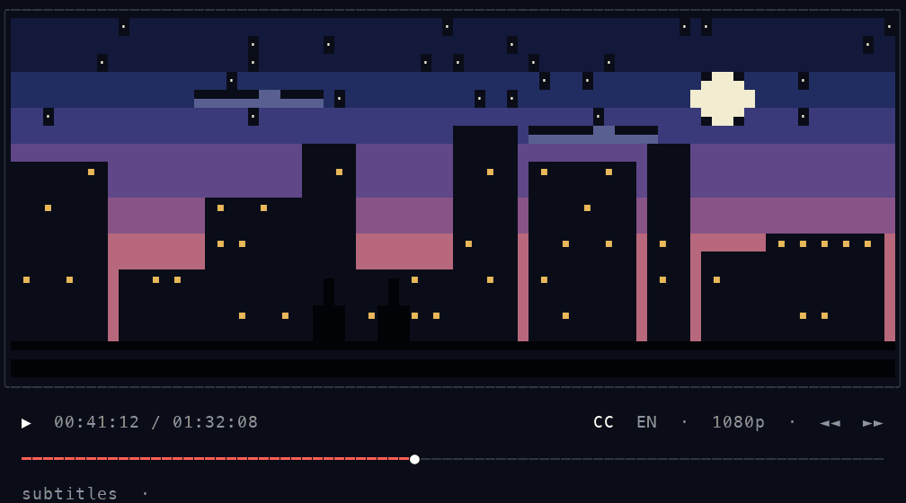

# Microprocessor

這個 repository 用來儲存**微算機實習的作業與實作程式**

目前收錄 Lab04、Lab05、Lab06，Lab01～Lab03 之後再補上。各次實習的操作方式、程式說明與驗證步驟，請參考對應資料夾內的 README。

- [Lab04：GPIO 遠端週邊控制](Lab04/README.md)
- [Lab05：SPI 光敏電阻與防盜快照](Lab05/README.md)
- [Lab06：Linux 驅動程式模組與字元裝置](Lab06/README.md)

## 目錄

```text
microprocessor/
├── README.md
├── Lab04/
├── Lab05/
└── Lab06/
```
